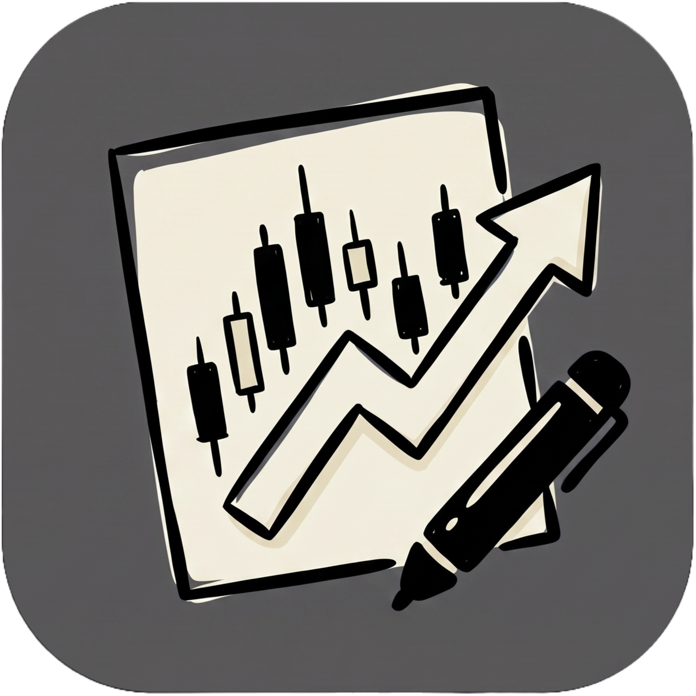
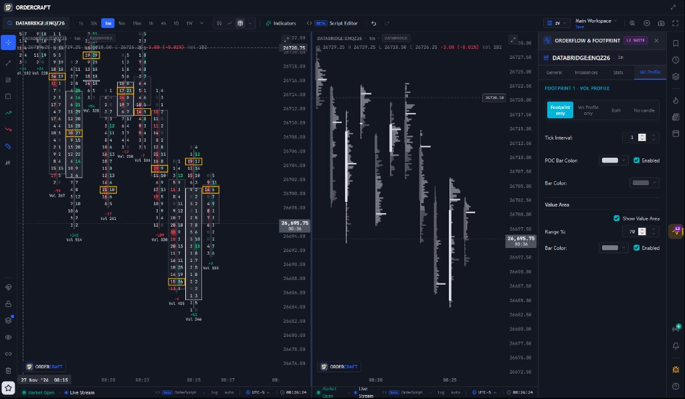

<div align="center">
  
  <h1>OrderCraft</h1>
  <p><strong>High-Performance Open-Source Orderflow, Footprint &amp; Quantitative Charting Workstation</strong></p>

  <p>
    <a href="https://github.com/ordercraft-hq/terminal/releases"></a>
    <a href="https://golang.org"></a>
    <a href="https://www.typescriptlang.org/"></a>
    <a href="LICENSE"></a>
    <a href="https://github.com/ordercraft-hq/terminal/pulls"></a>
  </p>
</div>

---



## What is OrderCraft?

**OrderCraft** is a 100% original, permissive open-source financial charting, **Level 2 orderflow**, and quantitative analysis workstation built from first principles with **Go**, **React 19**, **TypeScript**, and **Lightweight Charts v5** (Apache-2.0).

Designed for active futures/crypto orderflow traders, discretionary chartists, and quantitative developers, OrderCraft compiles into a **single standalone executable with an embedded frontend** (`//go:embed`). It combines real-time Level 2 bid/ask trade aggregation, HiDPI Canvas footprint & volume profile rendering, 500+ streaming WebAssembly indicators, a sandboxed Python-syntax scripting studio (**OrderScript**), multi-pane synchronized workspaces, and encrypted local SQLite persistence.

---

## What's New in `v0.3.0` — Level 2 Orderflow & Footprint Suite

- **Level 2 Market Data Bridge (`DataBridge`):** Native `L2DataProvider` streaming live tick-by-tick `TickData`, `OrderBookDepth`, `DeltaBar`, and price-level `FootprintBar` clusters (`BRIDGE_HTTP_URL` / `DATABRIDGE_URL`) with server-side aggregation and symbol alias support.
- **Bid × Ask & Delta Footprint Charts (`FootprintPrimitive`):** HiDPI canvas cluster candles featuring automatic Point of Control (**POC**) gold highlights, **Bid × Ask** or **Delta** cell coloring, smart cluster-to-candle conversion when zoomed out, and **4 display modes** (`Footprint only`, `Vol Profile only`, `Both`, `No candle`).
- **Diagonal & Stacked Imbalances Engine:** Rule-driven diagonal bid/ask imbalance detection with full local CRUD rule persistence, configurable imbalance ratio thresholds (e.g., `300%`), minimum delta volume filters, consecutive **Stacked Imbalance** zone extensions, zone borders, and mitigated-zone tracking.
- **Per-Bar & Range Volume Profile (`Vol Profile`):** Live per-bar tick-interval histograms with configurable **70% Value Area (VAH/VAL)** shading, POC bar highlighting, plus interactive **Fixed Range (`FRVP`)** and **Anchored Volume Profile** drawing tools.
- **Bar Statistics Overlay:** Per-bar headers and footers displaying Bar Delta, Delta %, Total Volume, and Min/Max Intra-bar Delta positioned above, below, or relative to candle direction.
- **Multi-Pane Sync & Server Time Precision:** Per-pane independent or linked symbols/timeframes/orderflow profiles (`1x1`, `2V`, `2H`, `3-split`, `4-grid`), `/api/time` clock synchronization, bar-close countdowns, and automatic chart-type fallback for L1-only feeds.
- **Security Hardening:** AES-256-GCM local credential encryption with strict OS keyfile ACLs, SSRF/DNS-rebinding-safe outbound HTTP transport, bounded Starlark script execution, and fail-closed token authentication for non-loopback hosts.

---

## Core Capabilities

| Capability | Highlights |
|---|---|
| **Level 2 Orderflow & Footprint (`v0.3.0`)** | Right-docked **Orderflow & Footprint [L2 Suite]** inspector with `General`, `Imbalances`, `Stats`, and `Vol Profile` tabs; diagonal/stacked imbalance rule builder; per-bar POC, Value Area, and delta histograms. |
| **500+ Streaming Indicators (`v0.2.0`)** | Pure-Go **Wazero** WebAssembly runtime offloading all time-series math off the UI thread, including full Volume Suite (`VWAP`, `OBV`, `ADL`, `FRVP`, `Anchored VWAP`), slope-colored trends, volatility bands, oscillators, and orderflow delta. |
| **OrderScript Studio (Beta)** | Docked Monaco Editor drawer for custom indicators in Starlark/Python syntax with instant AST validation, bounded step limits, capability-gated HTTP permissions, and `plot.line` / `plot.histogram` / `plot.band` outputs. |
| **Coordinate-Invariant Drawings** | 20+ interactive drawing tools persisted strictly in logical `(time, price)` coordinates (`ISeriesPrimitive`), plus semi-transparent `BandFillPrimitive` ribbons, `AnchoredVWAP`, and `FixedRangeVolumeProfile`. |
| **Multi-Provider Data Feeds** | Public WebSocket streams (**Binance Spot & Futures**, **Bybit v5**, **Coinbase Advanced**), BYOK broker APIs (**Alpaca Markets**, **OANDA v20**), and **Level 2 DataBridge**. See [Provider Setup Guide](docs/provider-guide.md). |
| **Command Palette & Workspace Sync** | Instant type-to-search or `Ctrl + K` command palette, synchronized crosshairs, symbol/timeframe linking across multi-chart grids, news flow, movers, screener, economic calendar, and price alerts. |
| **Local-First & Zero Telemetry** | All workspace layouts, drawings, imbalance rules, custom scripts, and encrypted API keys stay on your machine inside SQLite (`data/ordercraft.db`). |

---

## Quick Start

### Option 1: Download Prebuilt Binary
Download the latest single-executable release for Windows, macOS, or Linux from the [Releases Page](https://github.com/ordercraft-hq/terminal/releases):

```bash
# Run on localhost (serves embedded UI at http://127.0.0.1:8448 with auto-port fallback)
./ordercraft

# Launch directly in a standalone desktop browser window (Chromium / Edge / Brave)
./ordercraft --app-mode

# Bind to a network interface with mandatory token authentication (recommended for remote hosts)
./ordercraft --port 8448 --host 0.0.0.0 --token your-secret-token --db /path/to/ordercraft.db
```

### Option 2: Build from Source

**Prerequisites:**
- [Go 1.26+](https://golang.org/dl/)
- [Node.js 20+ & npm](https://nodejs.org/)

```bash
# 1. Clone the repository
git clone https://github.com/ordercraft-hq/terminal.git
cd terminal

# 2. Configure optional environment variables / provider keys
cp .env.example .env

# 3. Build the React frontend
cd frontend
npm ci
npm run build
cd ..

# 4. Build the single executable binary (embeds frontend/dist)
CGO_ENABLED=0 go build -ldflags="-s -w" -o ordercraft .

# 5. Launch OrderCraft
./ordercraft
```

---

## Essential Keyboard Shortcuts

| Shortcut | Action |
|---|---|
| `Ctrl + K` | Open Command Palette / Symbol & Timeframe Search |
| `Ctrl + S` / `Ctrl + O` | Save or Open Workspace Layout |
| `Ctrl + Alt + S` | Download Chart Snapshot |
| `Ctrl + Shift + S` | Copy Chart Snapshot to Clipboard |
| `Ctrl + Z` / `Ctrl + Y` | Undo / Redo Drawing Action |
| `Ctrl + Drag` | Clone / Duplicate Selected Drawing |
| `Shift + Drag` | Constrain Trendline to 45° Snap Angles |
| `Delete` / `Backspace` | Delete Selected Drawing Primitive |
| `Alt + R` | Reset Chart View |
| `Alt + Shift + →` | Scroll to Most Recent Live Bar |
| `Alt + T` / `H` / `J` / `V` / `C` | Trendline / Horizontal Line / Ray / Vertical / Cross Line |
| `Alt + F` / `Alt + Shift + R` | Fibonacci Retracement / Rectangle Tool |

---

## Architecture Overview

```text
github.com/ordercraft-hq/terminal/
├── main.go                     # Single binary entry point + //go:embed frontend/dist
├── internal/
│   ├── datafeed/               # Unified market data coordinator, delta aggregator & synthetic spreads
│   │   ├── aggregator.go       # High-frequency TickData -> DeltaBar & FootprintBar aggregation
│   │   ├── coordinator.go      # Multi-provider L1/L2 subscription router & LRU candle cache
│   │   ├── httpclient.go       # SSRF-safe HTTP client for outbound provider requests
│   │   └── providers/          # DataBridge (L2), Binance, Bybit, Coinbase, Alpaca, OANDA adapters
│   ├── indicators/
│   │   ├── wickra/             # Pure-Go Wazero WebAssembly streaming runtime (500+ indicators)
│   │   └── scripting/          # OrderScript Starlark-Go sandbox & technical analysis builtins
│   ├── server/                 # REST APIs, real-time WebSocket relay hub & static SPA server
│   ├── security/               # AES-256-GCM key storage, OS file ACLs, SSRF & permission checks
│   ├── storage/                # Pure-Go SQLite persistence layer (modernc.org/sqlite)
│   └── calendar/ news/ screener/ watchlist/  # Supporting market analysis services
├── frontend/
│   └── src/
│       ├── components/         # ChartPane, OrderflowPanel, WorkspaceGrid, RightSidebar, BottomDrawer
│       ├── drawings/           # Coordinate-invariant ISeriesPrimitive tools, FRVP & Anchored VWAP
│       ├── indicators/         # UniversalIndicatorConnector, FootprintPrimitive, BandFillPrimitive
│       ├── store/              # Zustand multi-pane workspace & sync state
│       └── transport/          # REST/WebSocket client & desktop runtime abstraction
└── docs/                       # Architecture diagrams, assets & provider setup documentation
```

---

## Legal & Financial Risk Disclaimer

**Not Financial Advice:** OrderCraft is an open-source technical charting and financial data-visualization software utility. Under no circumstances should any chart, footprint cluster, imbalance signal, indicator, calculation, drawing, or script be construed as financial, investment, trading, tax, or legal advice. Trading equities, futures, forex, options, and cryptocurrencies carries substantial risk of financial loss.

The software is provided **"AS IS"**, without warranty of any kind. Maintainers and contributors assume zero liability for trading losses, calculation discrepancies, market data latency, or execution errors.

For complete terms, review **[DISCLAIMER.md](DISCLAIMER.md)** and **[SECURITY.md](SECURITY.md)**.

---

## License & Attribution

- **Source Code:** Released under the permissive **[MIT License](LICENSE)**.
- **Third-Party Notices:** See **[NOTICE.md](NOTICE.md)** (`lightweight-charts` under Apache-2.0 and bundled open-source dependencies).
