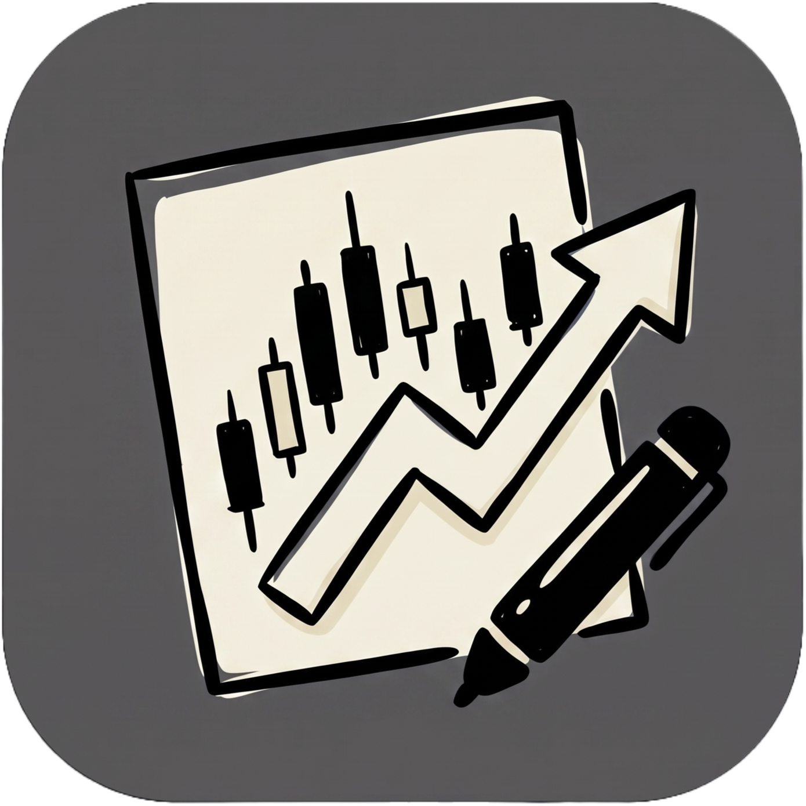

<div align="center">
  
  <h1>OrderCraft</h1>
  <p><strong>High-Performance Open-Source Financial Charting & Market Analysis Workstation</strong></p>

  <p>
    <a href="https://github.com/ordercraft-hq/terminal/releases"></a>
    <a href="https://golang.org"></a>
    <a href="https://www.typescriptlang.org/"></a>
    <a href="LICENSE"></a>
    <a href="https://github.com/ordercraft-hq/terminal/pulls"></a>
  </p>
</div>

---


## ⚡ What is OrderCraft?

**OrderCraft** is a 100% original, permissive open-source financial charting workstation built from first principles with **Go**, **React 19**, **TypeScript**, and **Lightweight Charts v5** (Apache-2.0). 

Designed for active discretionary traders, quantitative developers, and financial analysts, OrderCraft runs as a **single standalone binary with an embedded high-speed frontend** (`//go:embed`), a local **Docker container**, or a **PWA app**. It features sub-millisecond multi-exchange WebSocket streams, multi-chart synchronized workspaces, pixel-perfect drawing primitives, vectorized indicator math, and complete local SQLite persistence.

---

## 🚀 Key Features

| Capability | Highlights |
|---|---|
| **Multi-Provider Data Feeds** | Zero-config out-of-the-box public streams (**Binance Spot & Futures**, **Bybit v5**, **Coinbase Advanced**) and BYOK broker integrations (**Alpaca Markets**, **OANDA v20**). |
| **Unified Single Binary** | Go backend embeds the React SPA (`//go:embed`) and runs standalone with `--app-mode`, `--port`, and `--host` CLI flags. |
| **High-Precision Drawings** | Coordinate-invariant drawings persisted in logical `(time, price)` space. Includes Trendline, Ray, Horizontal Line/Ray, Parallel Channel, Fib Retracement & Extension, Anchored VWAP, and Risk/Reward Position Tool. |
| **Pro Volume Profile (FRVP)** | Fixed Range Volume Profile with 24-row histogram, Point of Control (POC), 70% Value Area (VAH/VAL), and live streaming bar extensions. |
| **Vectorized Technical Indicators** | Vectorized indicator calculations computed off-thread: SMA, EMA, WMA, HMA, VWAP, Bollinger Bands, Keltner Channels, SuperTrend, RSI, MACD, Stochastic RSI, ATR, CCI, and more. |
| **Multi-Chart Workspace Sync** | Dynamic 1x1, 2-split, 3-split, 4-grid layouts with crosshair synchronization, symbol linking, and timeframe alignment. |
| **Command Palette & Type-to-Search** | Instant symbol and timeframe switching by typing directly on the chart canvas or via `Ctrl + K`. |
| **Local-First & Zero Telemetry** | All layouts, drawings, watchlists, and encrypted API credentials remain 100% private in local SQLite (`data/ordercraft.db`). |

---

## 🏁 Quick Start

### Option 1: Download Prebuilt Standalone Binary
Download the latest single-binary release for your operating system from the [Releases Page](https://github.com/ordercraft-hq/terminal/releases):

```bash
# Run standalone (embedded UI on http://127.0.0.1:8448 with auto-fallback if busy)
./ordercraft

# Run in desktop application window mode (Chromium / Brave / Edge)
./ordercraft --app-mode

# Custom port and database location (or set PORT=8448 environment variable)
./ordercraft --port 8448 --host 0.0.0.0 --db /path/to/ordercraft.db
```

### Option 2: Run with Docker
```bash
docker run -d \
  -p 8448:8448 \
  -v $(pwd)/data:/data \
  --name ordercraft \
  ghcr.io/ordercraft-hq/terminal:latest
```
Open [http://localhost:8448](http://localhost:8448) in your browser.

### Option 3: Build from Source

**Prerequisites:**
- [Go 1.23+](https://golang.org/dl/)
- [Node.js 20+ & npm](https://nodejs.org/)

```bash
# 1. Clone the repository
git clone https://github.com/ordercraft-hq/terminal.git
cd terminal

# 2. Build the React frontend
cd frontend
npm ci
npm run build
cd ..

# 3. Build the single executable binary (embeds frontend/dist)
CGO_ENABLED=0 go build -ldflags="-s -w" -o ordercraft .

# 4. Launch OrderCraft
./ordercraft
```

---

## ⌨️ Essential Keyboard Shortcuts

| Shortcut | Action |
|---|---|
| `Ctrl + K` | Open Quick Search / Command Palette |
| `Alt + F` | Toggle Fullscreen Mode |
| `Ctrl + Drag` | Clone / Duplicate Selected Drawing |
| `Shift + Drag` | Constrain Line to 45° Snap Angles |
| `Delete` / `Backspace` | Delete Selected Drawing Primitive |
| `Alt + T` | Select Trendline Tool |
| `Alt + H` | Select Horizontal Line Tool |
| `Alt + R` | Select Rectangle Tool |
| `Alt + F` | Select Fibonacci Retracement Tool |
| `Alt + Shift + →` | Scroll to the Most Recent Live Candle |
| `Ctrl + Shift + S` | Save Workspace Layout |

---

## 🏛️ Architecture Overview

```
github.com/ordercraft-hq/terminal/
├── main.go                     # Single binary entry point + //go:embed frontend/dist
├── internal/
│   ├── datafeed/               # Unified market data coordinator & providers
│   │   ├── aggregator.go       # High-frequency tick-to-custom-timeframe bucketing
│   │   ├── coordinator.go      # Multi-exchange subscription router & memory cache
│   │   └── providers/          # Binance, Bybit, Coinbase, Alpaca, OANDA adapters
│   ├── server/                 # REST APIs, real-time WebSocket relay hub, static SPA server
│   ├── indicators/             # Vectorized technical indicator mathematical routines
│   └── storage/                # Pure-Go SQLite persistence layer (modernc.org/sqlite)
├── frontend/
│   ├── src/
│   │   ├── components/         # WorkspaceGrid, ChartPane, Titlebar, LeftDrawingBar, Modals
│   │   ├── drawings/           # Coordinate-invariant ISeriesPrimitive tools & renderers
│   │   ├── indicators/         # Indicator types, parameter models & presets
│   │   ├── store/              # Zustand state management
│   │   └── transport/          # Dual-mode client abstraction
└── docs/                       # Architecture, specifications & integration guides
    ├── architecture/           # System design & master roadmap
    ├── specs/                  # Mathematical & behavioral specifications
    └── provider-setup/         # Market data provider configuration guides
```

---

## 🛡️ Legal & Financial Risk Disclaimer

**Not Financial Advice:** OrderCraft is an open-source technical charting and financial data-visualization software utility. Under no circumstances should any chart, indicator, calculation, drawing, or content be construed as financial, investment, trading, tax, or legal advice. Trading equities, forex, futures, options, and cryptocurrencies carries significant risk of financial loss. 

The software is provided **"AS IS"**, without warranty of any kind. Maintainers and contributors assume zero liability for trading losses, calculation discrepancies, market data latency, or execution errors.

For complete terms, review **[DISCLAIMER.md](DISCLAIMER.md)** and **[NOTICE](NOTICE)**.

---

## 📄 License & Attribution

- **Source Code:** Released under the permissive **[MIT License](LICENSE)**.
- **Third-Party Attribution:** Incorporates `lightweight-charts` (Apache-2.0, Copyright TradingView, Inc.). Complete attribution and non-affiliation statements are documented in **[NOTICE](NOTICE)**.
